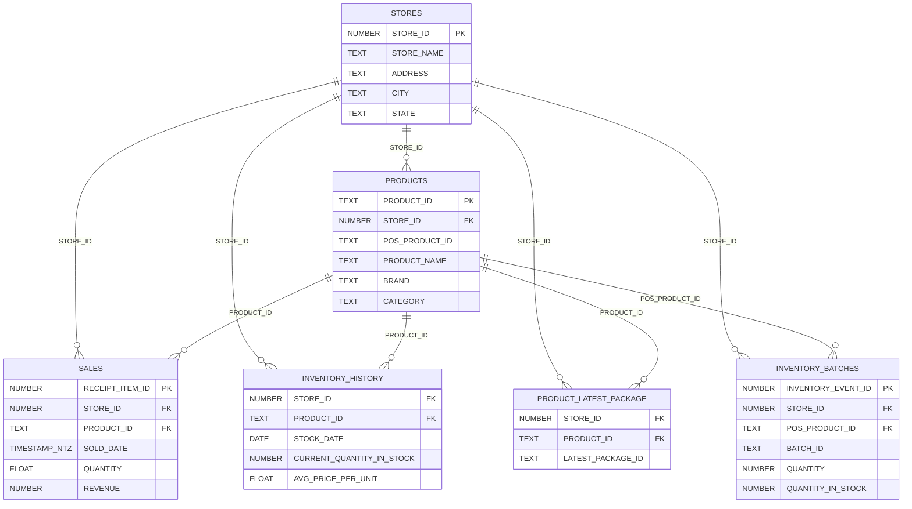

# Bridge Data Product

Bridge gives brands and distributors direct visibility into their sell-through performance at retail. By connecting point-of-sale data from retail partners, Bridge provides a real-time view of how your products move through stores — from receiving through to final sale.

## What's Included

Bridge delivers six secure views:

| View | Description |
|------|-------------|
| **STORES** | Store locations, addresses, and metadata for every retail partner carrying your products |
| **PRODUCTS** | Your product catalog as seen at retail — names, brands, categories, strains, potency, and current stock levels |
| **SALES** | Line-item transaction data including quantities, pricing, discounts, taxes, revenue, and customer demographics |
| **INVENTORY_HISTORY** | Daily snapshots of stock levels and average cost/price per unit for each product at each store |
| **INVENTORY_BATCHES** | Batch-level inventory detail including vendor, receive dates, quantities, cost, test results, and METRC/package data |
| **PRODUCT_LATEST_PACKAGE** | The most recent METRC/package ID associated with each product at each store |

## Data Relationships

The views connect through shared keys, primarily `STORE_ID` and `PRODUCT_ID`:

## Common Use Cases

- **Sell-through reporting** — Track unit and dollar sales of your products across retail partners over time
- **Inventory monitoring** — See current stock levels and receive alerts when products are running low at specific stores
- **Batch and package tracking** — Trace METRC package IDs and batch-level test results through the supply chain
- **Pricing analysis** — Compare base price, discounts, and revenue across stores and products
- **Distribution coverage** — Understand which stores carry your products and identify expansion opportunities

## Further Reading

- [Schema Reference](./schema.md) — Full column definitions and data types for every view
- [Sample Queries](./sample-queries.md) — Ready-to-run SQL examples for common analyses
- [Snowflake Basics](../snowflake-basics.md) — Connection setup and authentication
- [Glossary](../glossary.md) — Definitions of key terms
