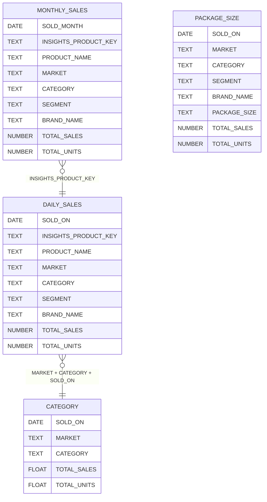

# Insights Data Product

Insights provides aggregated market-level sales data across the cannabis industry. Unlike Bridge and Retailer — which deliver your own store-level data — Insights gives you a view of the broader market, so you can benchmark your performance, track category trends, and understand competitive dynamics.

All data is aggregated and anonymized. You will never see individual store or transaction-level detail in Insights.

## What's Included

Insights delivers four secure views:

| View | Description |
|------|-------------|
| **CATEGORY** | Daily category-level sales and units by market — useful for high-level trend analysis |
| **DAILY_SALES** | Daily product-level sales data with full product attributes: brand, category, segment, package size, potency traits, and pricing metrics |
| **MONTHLY_SALES** | The same product-level detail as `DAILY_SALES`, rolled up to the month — better for trend analysis over longer time horizons |
| **PACKAGE_SIZE** | Sales and units broken down by package size, brand, category, and segment |

## Data Relationships

Insights views are relatively flat and independent. They share common dimensions (market, category, segment, brand) but are not joined through foreign keys the way Bridge and Retailer views are.

## Common Use Cases

- **Market sizing** — Use `CATEGORY` to understand total sales and unit volume by market and category over time
- **Brand benchmarking** — Compare your brand's sales against the broader market or specific competitors using `DAILY_SALES` or `MONTHLY_SALES`
- **Category and segment trends** — Track how categories and segments are growing or declining across markets
- **Product attribute analysis** — Filter by potency traits (THC/CBD), package size, strain, flavor, or cartridge type to understand what product attributes are driving sales
- **New product tracking** — Monitor how recently launched products are performing relative to established SKUs
- **Pricing intelligence** — Use `AVERAGE_PRICE_PER_ITEM` and `AVERAGE_COST_PER_ITEM` to understand pricing trends by category, segment, or brand
- **Package size optimization** — Use `PACKAGE_SIZE` to see which sizes drive the most volume in a given category and market

## Choosing Between Daily and Monthly

`DAILY_SALES` and `MONTHLY_SALES` share the same columns (except `SOLD_ON` vs `SOLD_MONTH`) and the same product-level grain. Use daily when you need precise timing — launch dates, promotional impact, day-of-week patterns. Use monthly when you're looking at longer-term trends, as it's smaller and faster to query.

## Further Reading

- [Schema Reference](./schema.md) — Full column definitions and data types for every view
- [Sample Queries](./sample-queries.md) — Ready-to-run SQL examples for common analyses
- [Snowflake Basics](../snowflake-basics.md) — Connection setup and authentication
- [Glossary](../glossary.md) — Definitions of key terms
