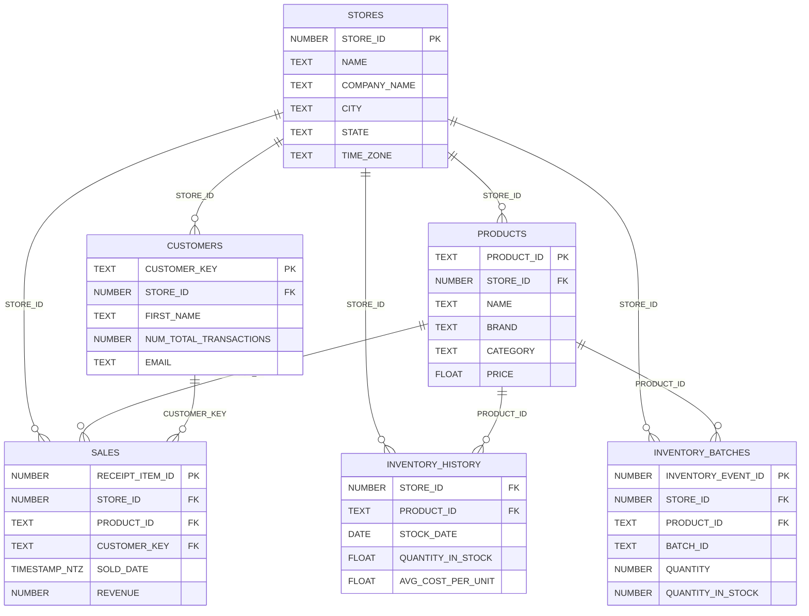

# Retailer Data Product

Retailer gives cannabis retailers full access to their own transactional data — sales, customers, products, and inventory — directly in Snowflake. This is the same granular data that powers Headset's analytics, delivered to your warehouse so you can build your own reports, dashboards, and integrations.

## What's Included

Retailer delivers six secure views:

| View | Description |
|------|-------------|
| **STORES** | Your store locations with addresses, time zones, square footage, and connection status |
| **PRODUCTS** | Your full product catalog — names, brands, categories, strains, potency, pricing, and current stock levels |
| **SALES** | Line-item transaction data with full detail: pricing, discounts, taxes, profit, payment type, employee info, customer demographics, delivery/wholesale flags, and more |
| **CUSTOMERS** | Customer profiles including demographics, contact info, referral source, and transaction counts |
| **INVENTORY_HISTORY** | Daily snapshots of stock levels and average cost per unit for each product at each store |
| **INVENTORY_BATCHES** | Batch-level inventory detail including vendor, receive dates, quantities, cost, and test results |

## Data Relationships

The views connect through shared keys. `SALES` is a denormalized view that includes store, product, employee, and customer fields directly on each row, so many analyses can be done without joins.

## Common Use Cases

- **Sales reporting** — Analyze revenue, units, and profit by store, product, brand, category, or time period
- **Customer analytics** — Identify your best customers, track repeat purchase behavior, and segment by demographics or referral source
- **Basket analysis** — Use `RECEIPT_ID` to group line items into baskets and understand what products are purchased together
- **Employee performance** — Track sales by employee across stores and time periods
- **Inventory management** — Monitor stock levels over time, identify slow-moving products, and track batch-level cost and test results
- **Delivery and channel mix** — Break down sales by in-store vs. delivery, medical vs. recreational, and wholesale vs. retail using the flags on `SALES`

## A Note on the SALES View

The `SALES` view is intentionally wide (52 columns). It denormalizes store, product, employee, and customer data onto each transaction row. This means you can answer most questions directly from `SALES` without needing to join other views. The separate `STORES`, `PRODUCTS`, and `CUSTOMERS` views are useful when you need the full set of attributes for those entities or want to analyze them independently.

## Example Queries

Ready-to-run SQL organized by topic:

- [Sales](./examples/sales.md) — Revenue by store, basket analysis, trends, discounts, medical/rec, delivery, payment types
- [Customers](./examples/customers.md) — Top spenders, visit frequency, retention, demographics, referral sources, lapsed customers
- [Inventory](./examples/inventory.md) — Stock levels, days of supply, batch tracking, vendor costs, dead stock
- [Products and Stores](./examples/products-and-stores.md) — Catalog overview, store comparison, revenue per sqft, employee performance

## Further Reading

- [Schema Reference](./schema.md) — Full column definitions and data types for every view
- [Snowflake Basics](../snowflake-basics.md) — Connection setup and authentication
- [Glossary](../glossary.md) — Definitions of key terms
